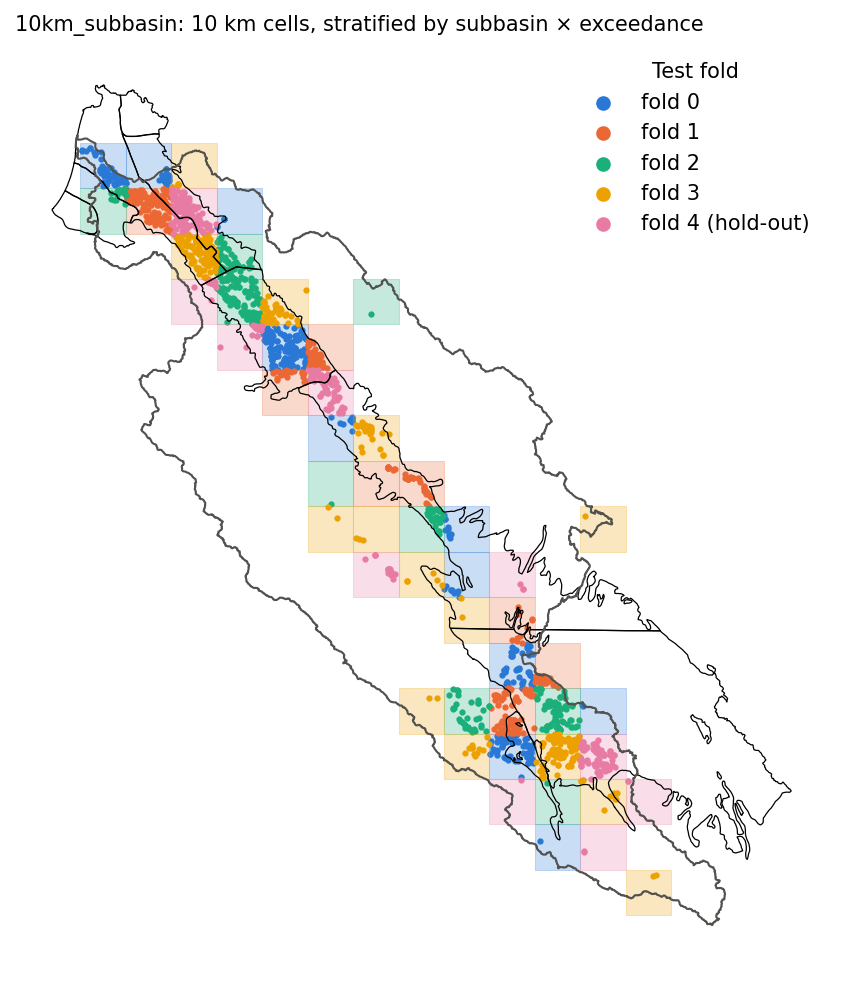
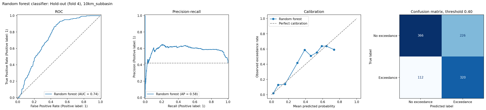

# Problem Statement

Agricultural runoff carries pollutants into rivers and coastal waters, harming ecosystems and water quality. Vegetated Treatment Systems (VTS), such as bioreactors, constructed wetlands and vegetated ditches, can help reduce this pollution, but they are not equally effective everywhere. Their success depends on where they are placed, how they are designed, and how well they are maintained.

This project will predict areas with higher risk of nitrate pollution in the Salinas Valley, California, and determine where additional monitoring is most needed. We will train our model on nitrate pollutant measurements in groundwater wells throughout the Salinas Valley and use soil characteristics, precipitation, temperature, and types of cropland as predictor variables. Once areas with high nitrate risk have been identified and monitored, this data can be used to propose locations for VTS infrastructure.

# Interactive groundwater nitrate risk map

```{python}
#| fig-cap: "Interactive map of the Salinas Valley, colored by low, moderate, and high risk of nitrate groundwater contamination predictions from our modelling. The layers show the risk assessment from our fitted Random Forest Classifier (Random Forest Model) and a hybrid model using our fitted Random Forest Classifier and the last groundwater measurement in that area (Hybrid Model)."
import sys
from pathlib import Path

sys.path.insert(0, str(next(p for p in [Path.cwd(), *Path.cwd().parents] if (p / "src").is_dir())))
from src import paths

ROOT = paths.ROOT

from src.models.interactive_risk_map import create_interactive_risk_map

create_interactive_risk_map()
```

# Data sources

This project uses data from several publicly accessible resources:

- United States Department of Agriculture (USDA) Natural Resources Conversation Service (NRCS) Web Soil Survey/SSURGO: <https://websoilsurvey.nrcs.usda.gov/>

- United States Geological Survey (USGS) National Hydrography: <https://www.usgs.gov/national-hydrography>

- California Natural Resources Agency, California Department of Water Resources crop mapping: <https://data.cnra.ca.gov/dataset/statewide-crop-mapping>

- USDA Cropland Data Layer: <https://data.nass.usda.gov/Research_and_Science/Cropland/sarsfaqs2.php>

- PRISM Climate Group: <https://prism.oregonstate.edu/>

- California Open Data, GAMA - Irrigated Lands Regulatory Program: <http://gamagroundwater.waterboards.ca.gov/gama/datadownload>

# Key performance indicators

The project is concerned with two factors: safety of public health, and cost of deploying and maintaining VTS. Nitrate pollution in water exceeding 10 mg/L is deemed harmful. We prioritize recall. If there is an actual exceedance above 10 mg/L, we need our model to capture it. Precision is a secondary priority. We do not want to deploy VTS in areas where it is not needed.

# Data exploration

- [Groundwater Cleaning](notebooks/data_cleaning/groundwater/gwater_clean.ipynb)
- [Soil Features](notebooks/data_cleaning/soils/Soil_data_cleanup_team.ipynb)
- [Precipitation Data](notebooks/data_cleaning/precipitation/prism_climate_cleaning_final.ipynb)
- [Crop Mapping](notebooks/data_cleaning/crop_mapping/crop_mapping_annual_2021_2024.ipynb)

# Data splitting strategy and limitations

We needed to adopt a data splitting strategy that accounts for the fact that nearby wells have similar nitrate levels. We also made sure to divide the percentage of exceedances among each fold. We used the strategy from Ref. \[3\], dividing our map into a square grid, performing a group k-fold split, and grouping points inside the grid cell. We evaluated the data leakage by comparing the RMSE of a k-nearest-neighbors (kNN) model to a model outputting the training mean. "Estimated leakage" is defined as $1 - \frac{\mathrm{RMSE}_{\mathrm{KNN}}}{\mathrm{RMSE}_\mathrm{mean}}$, where $\mathrm{RMSE}_{\mathrm{KNN}}$ is the root mean squared error of the kNN estimator and $\mathrm{RMSE}_{\mathrm{mean}}$ is the root mean squared error of predicting the mean. If the kNN estimator performs similarly to predicting the mean, then the estimated leakage should be approximately 0; positive values indicate that kNN is performing better. We found that 10 km equal-area cells had approximately no leakage.

However, from preliminary modeling with this data split strategy, we found large variation in scoring across folds, with some folds performing much worse. We realized that grid cells inside the Salinas Valley subbasins were not being uniformly distributed among folds. Altering our data split strategy again, we created a subbasin-stratefied split, finding good fold-to-fold stability, with little leakage, with 5 km and above size subbasin-stratefied splits. In the end, we chose the 10 km subbasin split, since we did not perform extensive leakage testing, and we preferred to be conservative. The resulting limitation of our model is that it cannot easily generalize to new locations, and relies upon stratification amongst subbasin data.

{width=40% fig-alt="XX." #fig-stratify}

# Modeling plan and results

- [Feature Selection](notebooks/feature_selection.ipynb)
- [Regression](notebooks/regression_models.ipynb)
- [Classification](notebooks/classification_models.ipynb)

We approached modeling from two angles: regression and classification. The regression task seeks to directly predict the nitrate pollutant concentration. We compared a dummy model and simple linear model to linear models with two regularization strategies (ridge and lasso), a decision tree model, a random forest model, and an XGBoost regressor. Per model, we tuned hyperparameters with extensive nested cross validation, using `GridSearchCV` or `RandomizedSearchCV` in each set of training folds, holding one whole fold out at the time, so the test fold is never used for tuning. Our base scoring metric was RMSE, where our lowest RMSE came from the random forest model, averaging 0.973 per fold, with only small improvement over the dummy, 1.208. Plots of predicted nitrate values versus observed nitrate values showed poor reproductions of real trends, with high residuals. We concluded that the features available did not encode enough information to produce accurate regression models.

The classification task seeks to classify locations as exceedances (above nitrate concentrations of 10 mg/L) or non-exceedances. We compared a dummy model and simple logistic model to logistic models with two regularization strategies (L1 and L2), a decision tree model, a random forest model, and an XGBoost classifier. Our basic scoring metric was AUC score, where again the random forest was the strongest performing, averaging 0.827 across training folds,, compared to the weakest performing, the decision tree model, with an AUC of 0.765. Per our KPIs, the f1 score, balancing recall and precision, was highest for the random forest model with the slightly lower cutoff threshold of \~0.4, with an f1 of 0.673. We found the random forest model to be the most stable across folds and perform the strongest overall.

On our final model evaluation with the holdout set, our random forest classifier performance ended up being weaker, with an AUC of 0.741, compared with 0.827. Similarly, the f1 dips to 0.654 at a cutoff threshold of 0.4. Upon some investigation, we found that this particular fold had a much higher percentage of exceedances (42%, compared to \~30% in the training folds), which suggests weaker extrapolation to the unseen data. Essentially, the model generalizes to unseen areas about as well as cross-validation suggests when every subbasin is represented, but it performs worse where a heavily contaminated subbasin is under-represented in training. In the future, we should be more thorough in our splitting strategy, ensuring that the training and holdout contained more general representations of the dataset.

{width=100% fig-alt="XX." #fig-final}

# Next steps

We see three next steps. First, would like to add additional features that explain why nitrate builds up, like how deep the wells are and how much fertilizer is applied compared to what crops use. We want to test the model again on new 2026 samples from every part of the Salinas Valley.

Second, we plan to explore the possibility of creating a hybrid model that combines our predictions with real measurements. For instance, where a well nearby has been tested, we can use that, but where nobody has tested, the model fills the gap. A hybrid modeling approach points to 318 small areas where nitrate is likely too high and no one has tested the water.

Third, using this hybrid modeling approach, together with new drainage, available space, soils and community needs, we can help choose where to build plant-based systems that clean farm runoff.

# Selected scientific references

\[1\] Ransom et al. (2017), A hybrid machine learning model to predict and visualize nitrate concentration throughout the Central Valley aquifer: <https://pubs.usgs.gov/publication/70187880>

\[2\] Nolan, Fienen & Lorenz (2015), A statistical learning framework for groundwater nitrate models of the Central Valley: <https://pubs.usgs.gov/publication/70157562>

\[3\] Belitz et al., 2010, Estimation of aquifer scale proportion using equal area grids: Assessment of regional scale groundwater quality: <https://agupubs.onlinelibrary.wiley.com/doi/full/10.1029/2010WR009321>